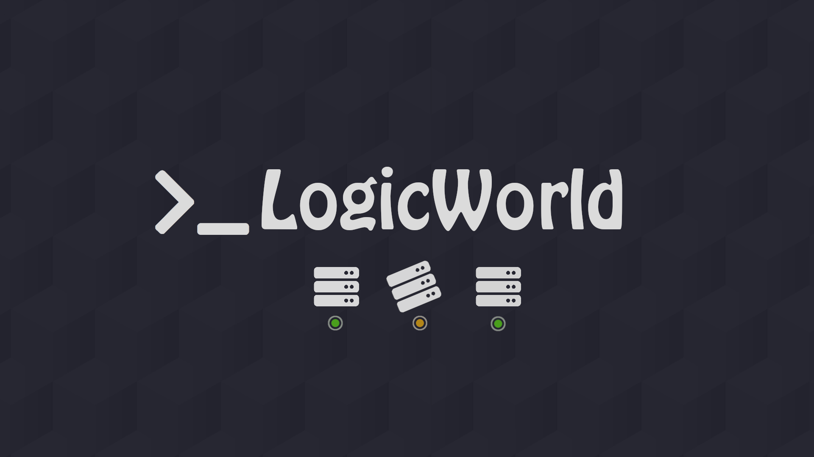

# LW-status



## Description

Lightweight, cloud-based utility for tracking state of [Logixy.net](https://logixy.net/)`s server infrastructure.

### Current developed features

- API for checking server online stats;
- Server ping check;
- Dark/snow mode;
- Reload stats button;
- Supporting mobile devices;
- Server list and config storing at Firestore.
- Player activity charts and equipment availability history (24 hours / 7 days / 30 days).
- Admin UI for infrastructure and settings, with Firebase Authentication and server-enforced administrator membership.
- Automatic English/Russian/Ukrainian UI localization with a manual language override.

### Administration

See [admin setup and security](docs/admin.md) for the one-time Email/Password
provider setup, granting the first administrator, deployment and local development.
The UI is at `/admin`; no database credentials or service-account keys belong in it.

### Monitoring history

The **History** page (`/log`) reads `/api/history?days=1` (also accepts `7` and `30`).
The `collectHistory` scheduled Cloud Function records player counts from the existing
Logixy game API and TCP availability of configured equipment every 5 minutes.
Collection runs independently of website visitors. Samples are stored in the
Firestore `history` collection, with daily cleanup of records older than 30 days.
Direct client access to this collection is denied by the existing Firestore rules;
only the read-only HTTP function exposes history. Hosts and ports are not exposed
in equipment identifiers (stable hashes). Set an explicit unique `id` in each
`config/servers` entry to preserve continuity when changing its host or port.

**Deployment:**

1. Install frontend dependencies with Node 16.20.2 (`npm ci` in the root).
   Install migrated function dependencies with Node 22 (`npm ci --prefix functions`).
2. Use a Firebase project on the **Blaze** plan with Cloud Scheduler / Pub/Sub
   enabled and the existing `config/config` and `config/servers` documents configured.
3. Run `npm run build` with Node 16, then switch to Node 22 and run
   `npx --yes firebase-tools@15.34.2 deploy --only functions,hosting,firestore:rules --project lw-status`.
   This deploys the monitoring/admin functions, Hosting rewrites and security rules.
   The backend migration must be committed first;
   see **GitHub Actions deployment** below for the required files and SDK versions.
4. Wait for the first scheduled measurement (up to 5 minutes). Historical data
   before deployment cannot be reconstructed; the UI shows an empty state.

For a local UI preview, run `npm ci` and `npm start`, then open
`http://localhost:4200/log`. Development mode enables synthetic history by default
(`HISTORY_MOCK: true` in `src/environments/environment.ts`), including player
activity, recovered outages, an unrecovered storage outage, and monitoring gaps.
All three period filters work without Firebase. The **Demo preview** banner labels
these as synthetic measurements. Use **Use real API** to switch to the configured
backend, or set `HISTORY_MOCK: false` to start with real measurements. Production
always uses the real API and does not offer the demo switch.

For real local measurements, use the existing Firebase emulators and Angular dev server.
The Functions emulator does not trigger schedules automatically: invoke
`collectHistory()` in the Firebase Functions shell to collect a sample into the
Firestore emulator. Player counts are fetched from the real game endpoint, not
the frontend dummy JSON. The history API URL is configured in `src/environments/`.

Uptime is the ratio of successful TCP checks to recorded checks, not a guarantee
of application health. Failed collectors and missing periods are excluded rather
than counted as online or offline. Coverage is shown separately. Outages are
grouped only across consecutive observations; recovery is never inferred across
gaps. Player charts show real measured counts and timestamps. Longer periods
select first/minimum/maximum/last observations per interval (at most 480 dots),
preserving peaks without inventing averages or drawing across missing samples.
Pointer/touch tooltips and keyboard arrows inspect the same points used by the
SVG line. Dates, numbers and tooltips follow the selected UI language.
Tests: `npm test -- --watch=false --browsers=ChromeHeadless`.
History shows currently configured devices only: removing a device hides its
past observations and outages from the API/UI without deleting stored samples.
Paused devices remain visible; new devices initially show no measurements.

The outage log starts with five entries, offers ten more at a time, and can be
collapsed again. Live infrastructure alerts appear above both Dashboard and
History, independently of the selected historical period. One shared status
stream checks every minute and stops when neither page is visible. Monitoring
API failures are marked as unknown/stale, not invented equipment outages; old
unrecovered historical incidents are not assumed to still be active. Demo
history uses explicitly labeled demo alerts without querying live infrastructure.

### Interface language

English (`en`), Russian (`ru`) and Ukrainian (`uk`) are supported. The app chooses
the first supported entry in `navigator.languages` (including region variants
such as `ru-RU`/`uk-UA`), otherwise English. The navigation menu allows choosing
a language or returning to automatic device-language mode. Only that public
preference is persisted in `lw-status-language`; authentication stays memory-only.
`document.lang`, UI text, date/number formatting, chart tooltips and confirmation
dialogs update together. User-entered device names and API model status codes
are not translated or rewritten. Translation sources are in `src/app/i18n/`.

### GitHub Actions deployment

- Push to `main`: plan changes and deploy **Hosting** and **Functions / rules**
  in independent jobs. A backend deployment failure does not block or roll back
  the website release. Each job retains its own failure status in Actions.
- Frontend-only changes do not redeploy Functions. Changes are compared against
  the last successful production push, not simply the previous commit, so a
  failed or superseded backend release is retried rather than silently forgotten.
  If no reliable baseline is available, all targets are scheduled.
- Push to `dev` or `dev-angular`: deploy **only** the shared `dev` Hosting preview
  (expires after 30 days). It uses the already deployed backend; it does not
  deploy or isolate Functions, and does not deploy security rules.
- Both workflows can be started from the **Actions** tab with **Run workflow**
  on their respective branches. Deployments to the same target are serialized.
- Production manual runs offer `all`, `hosting` or `backend`. Choose `hosting`
  to recover a UI release without waiting for a backend fix. Run the workflow
  on `main` rather than re-running an obsolete commit after newer changes exist.
- The run summary reports website/backend outcomes separately. Hosting publishes
  a public, non-cacheable [`build-info.json`](https://status.logixy.net/build-info.json)
  containing only the frontend commit and build timestamp, and verifies that
  both the default Firebase domain and custom domain serve that exact commit.
  HTML entry points (`/`, `/admin`, `/log`, `/index.html`) are revalidated rather
  than kept stale in browser caches; hashed JS/CSS assets are unchanged.
- The Angular 14 build temporarily uses Node 16.20.2, which is EOL. Node 22 is
  used for Functions dependencies and Firebase CLI 15.34.2. Upgrade Angular to
  remove the legacy build runtime; do not run Firebase CLI on Node 16.
- Installs use `npm ci`; always commit the corresponding lockfiles.

In **Settings → Secrets and variables → Actions**, configure the repository
secret `FIREBASE_SERVICE_ACCOUNT_LW_STATUS` with the service account JSON.
The workflows use Google Application Default Credentials; no interactive login
or `FIREBASE_TOKEN` is needed. They do not depend on the GitHub owner's name.
Do not commit credentials or print them in logs. The service account needs
permissions for Hosting and, for production, Cloud Functions deployment,
Cloud Scheduler / Pub/Sub provisioning, and permission to act as the runtime
service account. It also needs permission to release Firebase/Firestore rules.
The old Hosting-only service account may need additional IAM
permissions. Have a project administrator grant the required access rather
than granting Owner indiscriminately. Missing APIs may also require an
administrator to enable them once. GitHub repository permissions do not grant
Google Cloud IAM permissions.

**One-time prerequisite after the Cloud Shell migration:** save the working
backend changes in Git before enabling production auto-deploy:

```sh
# In the Cloud Shell checkout where the Functions deployment succeeded:
git diff -- functions/package.json functions/package-lock.json functions/index.js
git add functions/package.json functions/package-lock.json functions/index.js
git commit -m "Migrate Firebase Functions to Node 22 and current SDKs"
git push origin main
```

Use a pull request if `main` is protected. The committed runtime must be Node 22,
dependencies must include `firebase-functions` 6+ and `firebase-admin` 13+, and
the existing first-generation handlers must import `firebase-functions/v1`.
Do not commit only `engines.node`: both SDK updates and the updated lockfile are
required. CI checks this and stops with an actionable error rather than
deploying the old configuration over the working Cloud Shell deployment.
No automatic `npm audit fix --force` or forced function deletion is performed.
Firebase deploy debug output is captured privately by the CI wrapper; only
selected, redacted Google API error messages are printed on failure. Raw debug
logs and credential files are never uploaded as artifacts. A failed backend job
still fails the overall workflow; a green Hosting job is not proof of backend
success. API changes must remain backward-compatible with separately released
frontends. Initial releases introducing a new function/authorization model may
require deploying the backend/rules first before enabling the UI/provider.

### Update history

- __Mid of 2021__ First usable version.
- __End of 2021__ Better design (*sort of* ).
- __24.02.2022__ __*__WAR IN UKRAINE__*__
- __16.03.2022__ Implemented use of Firestore. *Update your server list and config faster!*
- __22.08.2022__ Implemented asynchronous ping in API.
- __16.10.2022__ Through pain and tears Angular version of service is available!
- __30.01.2024__ Mograte to logixy.net

###### See ya in peace \#nowar
